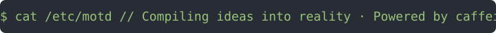

<div align="center">



<p>
  <a href="https://luozhouyang.com"></a>
  <a href="https://github.com/luozhouyang"></a>
</p>

</div>

---

## `$ cat whoami.log`

```yaml
name:       luozhouyang
was:        NLP & Backend Engineer @ Alibaba   # turned words into vectors, at scale
is:         Full-Stack Indie                   # turns caffeine into commits
layers:     Frontend → Backend → LLM → Cloud-Native
weapons:    TypeScript · Python · Cloudflare Workers · Kong · Kubernetes
fun_fact:   most devs go frontend → backend → AI; I went the exact opposite
```

## `$ ls ~/missions --featured`

| repo | mission | status |
| :-- | :-- | :-- |
| **[python-string-similarity](https://github.com/luozhouyang/python-string-similarity)** | String similarity and distance measures in Python. Pays rent in stars. |   |
| **[AutoPhraseX](https://github.com/luozhouyang/AutoPhraseX)** | Automated phrase mining from massive text corpora. |   |
| **[transformers-keras](https://github.com/luozhouyang/transformers-keras)** | Transformers, but in TensorFlow 2 / Keras. |   |

## `$ tail -f activity.log`

| repo | last commit | commits / 12 mo |
| :-- | :-- | :-- |
| [openchat](https://github.com/luozhouyang/openchat) |  |  |
| [localclaw](https://github.com/luozhouyang/localclaw) |  |  |
| [coffer-desktop](https://github.com/luozhouyang/coffer-desktop) |  |  |
| [ubuntu-ios-skill](https://github.com/luozhouyang/ubuntu-ios-skill) |  |  |
| [litecart](https://github.com/luozhouyang/litecart) |  |  |

---

<div align="center">

<sub><code>&gt; EOF — go build something.</code> · <a href="https://luozhouyang.com">luozhouyang.com</a></sub>

</div>
